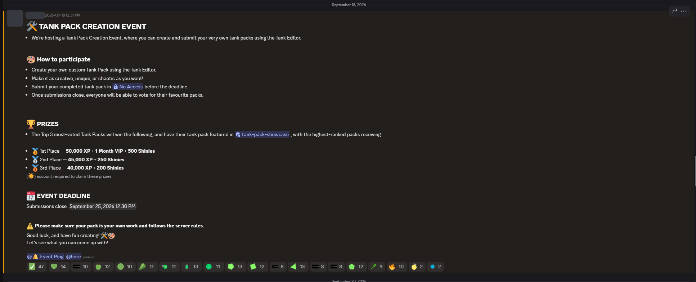
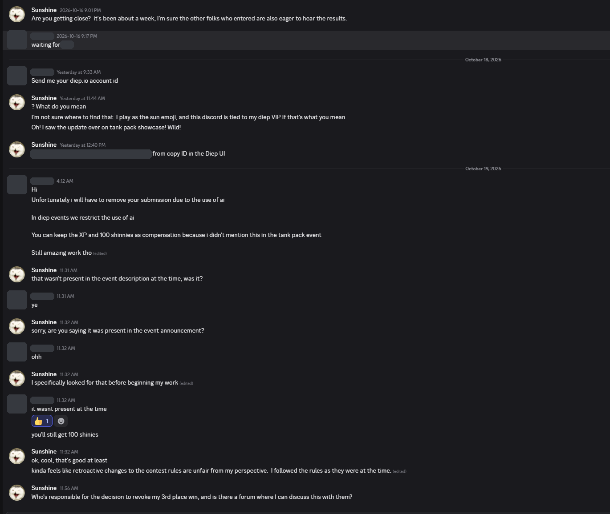
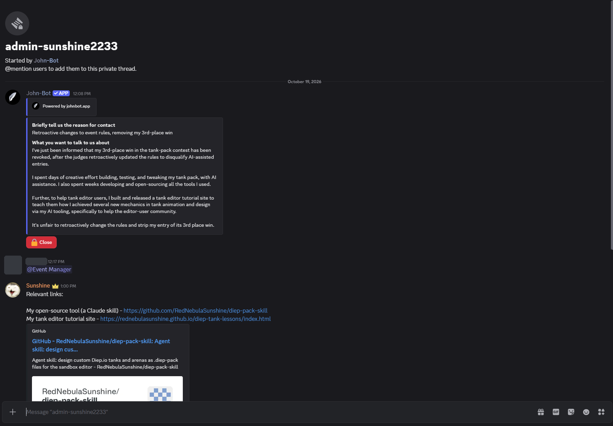

# The Tank Pack Creation Event, 2026

In September 2026 the Diep.io Discord server held a **Tank Pack Creation Event**. Players made tank
packs for the sandbox tank editor, and the server voted for their favourites.

**Halloween v0.12.1**, a pack made with this skill, placed **3rd of 29**, with **47 of 809 votes**.

- It was 2 votes behind 2nd place and 8 votes behind 1st.
- In early October, after the pack was entered, the maintainer added a line to its description:
  "The creator notes that AI was used to create and edit this diep-pack." It was the only entry
  that said so.
- On 19 October 2026 the organiser removed the entry from the results, because Diep events restrict
  the use of AI. The organiser confirmed that the event announcement did not say this at the time.
  The entry kept its XP and was given 100 Shinies as compensation.
- The maintainer has asked the server's admins to review the decision.

## How the pack was made

The maintainer designed the pack: the theme (a trick-or-treat night), the 19 tanks in five classes,
the 1970s die-cut look, and the moves (chattering jaws, swinging capes, eyes that track, familiars,
broom flight). The maintainer and the skill went through many rounds of renders and play tests, and the
maintainer chose what stayed and what changed in each round.

The skill did what the editor makes slow by hand: the pack's JSON, the exact position and setting of
every part, and the checks against the game's limits. That is what the skill is for. It takes away the
fiddly part of the work, so that a person can spend their time on the ideas.

## Results

| Place | Entry | Votes | Share | Behind 1st | Entry logged | Prize in the announcement |
|---:|---|---:|---:|---:|---|---|
| 🥇 1 | Entry 28 | 55 `████████████` | 6.8% | – | 2026-09-26 | 50,000 XP + 1 month VIP + 500 Shinies |
| 🥈 2 | Entry 9 | 49 `███████████` | 6.1% | 6 | 2026-09-20 | 45,000 XP + 250 Shinies |
| 🥉 3 | **Halloween v0.12.1** (made with this skill) | **47** `██████████` | 5.8% | 8 | 2026-10-01 | 40,000 XP + 200 Shinies |
| 4 | Entry 4 | 45 `██████████` | 5.6% | 10 | 2026-09-19 |  |
| 5 | Entry 19 | 41 `█████████` | 5.1% | 14 | 2026-09-25 |  |
| 6 | Entry 20 | 40 `█████████` | 4.9% | 15 | 2026-09-25 |  |
| 7 | Entry 26 | 39 `█████████` | 4.8% | 16 | 2026-09-25 |  |
| 8 (tie) | Entry 5 | 37 `████████` | 4.6% | 18 | 2026-09-19 |  |
| 8 (tie) | Entry 18 | 37 `████████` | 4.6% | 18 | 2026-09-25 |  |
| 10 (tie) | Entry 2 | 36 `████████` | 4.4% | 19 | 2026-09-19 |  |
| 10 (tie) | Entry 27 | 36 `████████` | 4.4% | 19 | 2026-09-25 |  |
| 12 | Entry 25 | 32 `███████` | 4.0% | 23 | 2026-09-25 |  |
| 13 | Entry 21 | 31 `███████` | 3.8% | 24 | 2026-09-25 |  |
| 14 (tie) | Entry 16 | 29 `██████` | 3.6% | 26 | 2026-09-24 |  |
| 14 (tie) | Entry 22 | 29 `██████` | 3.6% | 26 | 2026-09-25 |  |
| 16 | Entry 24 | 27 `██████` | 3.3% | 28 | 2026-09-25 |  |
| 17 | Entry 12 | 24 `█████` | 3.0% | 31 | 2026-09-21 |  |
| 18 | Entry 3 | 23 `█████` | 2.8% | 32 | 2026-09-19 |  |
| 19 | Entry 8 | 20 `████` | 2.5% | 35 | 2026-09-20 |  |
| 20 | Entry 10 | 19 `████` | 2.3% | 36 | 2026-09-20 |  |
| 21 | Entry 1 | 17 `████` | 2.1% | 38 | 2026-09-19 |  |
| 22 | Entry 11 | 16 `███` | 2.0% | 39 | 2026-09-20 |  |
| 23 (tie) | Entry 6 | 14 `███` | 1.7% | 41 | 2026-09-19 |  |
| 23 (tie) | Entry 23 | 14 `███` | 1.7% | 41 | 2026-09-25 |  |
| 25 | Entry 13 | 13 `███` | 1.6% | 42 | 2026-09-22 |  |
| 26 (tie) | Entry 14 | 12 `███` | 1.5% | 43 | 2026-09-22 |  |
| 26 (tie) | Entry 17 | 12 `███` | 1.5% | 43 | 2026-09-24 |  |
| 28 | Entry 15 | 10 `██` | 1.2% | 45 | 2026-09-23 |  |
| 29 | Entry 7 | 5 `█` | 0.6% | 50 | 2026-09-19 |  |

29 entries, 809 votes. Median 29 votes.

- **Share** is the entry's part of all 809 votes. The bar compares each entry with 1st place.
- **Entry logged** is the date the export records for the entry. The announcement gave the submission
  deadline as 25 September 2026, 12:30 PM. *Halloween v0.12.1* was logged on 1 October because the
  maintainer asked for a late entry and the organisers granted it.
- **Prize in the announcement** is what the announcement offered for the top three places.
- Other entries are shown by their `pack_id` in the export. This repository does not name other
  players' packs.

## Source

The table is made from the event's vote export, `tank-pack-event.sqlite`, which was shared in public
on the Diep.io Discord server. It was downloaded on 19 October 2026. The data comes from two tables:

- `tankPack`: each entry's `pack_id`, title, description and `created_at` time.
- `voting`: each entry's `vote_count`.

The export does not record individual voters or the times of votes.

## Screenshots

The organiser's name and avatar, another staff member's name, the server's member list and the
maintainer's diep.io account ID are covered in these copies.

**The event announcement (18 September 2026).** It says to create the pack "using the Tank Editor"
and that the pack must be "your own work". It does not mention AI.

**The organiser's message (16 to 19 October 2026).** The organiser removes the entry for the use of AI
and confirms that the rule "wasnt present at the time".

**The request for review (19 October 2026).** The maintainer asks the admins to review the decision.

